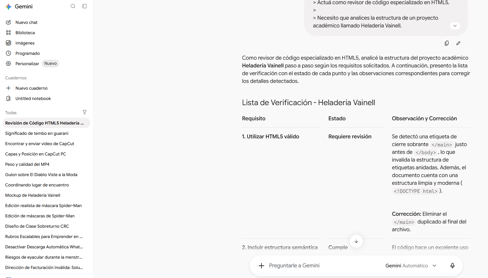
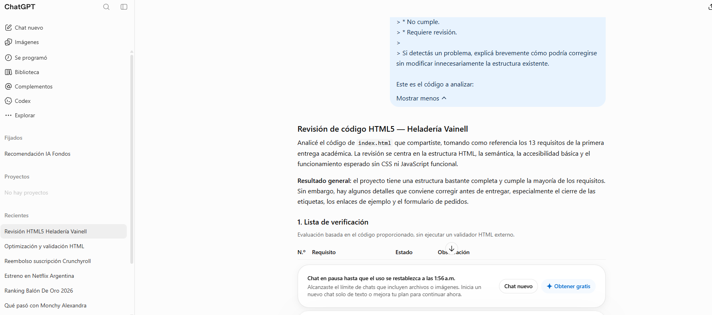

# Comparativa de modelos de IA

## Objetivo

Comparar los modelos y herramientas de IA utilizados en los cinco prompts del proyecto Heladería Vainell, observando el aporte de cada uno según la tarea realizada.

## Comparación

Durante el desarrollo del proyecto se utilizaron diferentes herramientas y modelos de IA para resolver tareas relacionadas con la estructura, el diseño y la validación del sitio web.

| Prompt | Tarea | Modelo / herramienta de IA | Método | Resultado / aporte |
|---|---|---|---|---|
| Prompt 1 | Estructura semántica inicial en HTML5 |Claude| Zero-shot Prompting | Propuso una estructura inicial para organizar el contenido del proyecto utilizando etiquetas semánticas HTML5. |
| Prompt 2 | Generación del HTML inicial | Use.ai | Role prompting | Generó una propuesta de código HTML5 utilizando etiquetas semánticas y contemplando aspectos de accesibilidad y futuras incorporaciones de CSS y JavaScript. |
| Prompt 3 | Planificación del diseño responsive |Chatbox ai | Zero-shot Prompting | Permitió analizar una propuesta de diseño responsive y definir criterios para adaptar la interfaz a diferentes tamaños de pantalla. |
| Prompt 4 | Creación del mockup | GPT-4o | Few-shot Prompting | Generó una propuesta visual para organizar las principales secciones de la página y utilizarla como referencia para el desarrollo frontend. |
| Prompt 5 | Validación de requisitos | Gemini | Chain-of-thought guiado | Permitió realizar una lista de verificación para comprobar el cumplimiento de los requisitos definidos para el proyecto. |


## Comparación de dos modelos en la misma tarea

**Tarea:** validar el `index.html` contra los 13 requisitos de la primera entrega (Prompt 5, chain-of-thought guiado). Se usó el mismo prompt y el mismo código en Gemini y en ChatGPT. La prueba original del Prompt 5 se había hecho sobre una versión anterior del código, sin imágenes, por eso se repitió con el código actual para poder comparar.

| Criterio | Gemini | ChatGPT |
|---|---|---|
| Cubrió los 13 requisitos | Sí | Sí |
| Resultado | 12 Cumple, 1 Requiere revisión | 9 Cumple, 4 Requiere revisión |
| Detectó el `</main>` sobrante | Sí, sin indicar la línea | Sí, indicó las líneas 598 y 642 |
| Enlaces provisionales (`href="#"`) | No los señaló | Sí (requisito 7) |
| Textos y cifras a verificar | No los señaló | Sí (requisito 5) |
| Coherencia entre requisitos | Marcó "Cumple" en el requisito 3 aunque reportó el cierre duplicado | Marcó "Requiere revisión" en los requisitos 1 y 3 |
| Correcciones propuestas | Breves, solo para el `</main>` | Detalladas, con código |
| Respetó el alcance del prompt | Sí | Se excedió (lista de tareas y mejoras opcionales) |

**Análisis:** los dos encontraron el error estructural principal. Gemini dio una revisión más rápida y breve, pero más permisiva: pasó por alto los enlaces provisionales y los datos comerciales a verificar. ChatGPT fue más crítico y concreto, con líneas y fragmentos de código, aunque agregó contenido que no se pedía.

**Modelos utilizados:** Gemini y ChatGPT. Fecha de la prueba: 16/10/2026.
---

## Evidencia

**Prompt utilizado:** el texto exacto está en [Prompt 5](prompts-5.md).

**Respuestas completas:**
### Respuesta de Gemini:

```
Como revisor de código especializado en HTML5, analicé la estructura del proyecto académico **Heladería Vainell** paso a paso según los requisitos solicitados. A continuación, presento la lista de verificación con el estado de cada punto y las observaciones correspondientes para corregir los detalles detectados.


## Lista de Verificación - Heladería Vainell

| Requisito | Estado | Observación y Corrección |
| --- | --- | --- |
| **1. Utilizar HTML5 válido** | **Requiere revisión** | Se detectó una etiqueta de cierre sobrante `</main>` justo antes de `</body>`, lo que invalida la estructura de etiquetas anidadas. Además, el documento cuenta con una estructura limpia y moderna (`<!DOCTYPE html>`). <br>

<br>

<br>**Corrección:** Eliminar el `</main>` duplicado al final del archivo. |
| **2. Incluir estructura semántica** | **Cumple** | El código hace un excelente uso de etiquetas semánticas modernas como `<header>`, `<main>`, `<section>`, `<article>`, `<figure>`, `<figcaption>` y `<address>`. |
| **3. Contener header, main y footer** | **Cumple** | Se encuentran claramente definidos y delimitados los tres contenedores principales de la página. |
| **4. Incluir navegación** | **Cumple** | Utiliza la etiqueta `<nav>` con el atributo `aria-label` en las distintas secciones donde se requiere navegación (menú principal, categorías del catálogo y redes/pie de página). |
| **5. Contener textos descriptivos reales** | **Cumple** | Los textos son coherentes con la temática de una heladería artesanal, incluyendo descripciones de productos, eslóganes, pasos y testimonios verosímiles. |
| **6. Incluir imágenes con atributo alt** | **Cumple** | Todas las etiquetas `` analizadas poseen su respectivo atributo `alt` con descripciones claras y accesibles. |
| **7. Contener enlaces** | **Cumple** | Contiene enlaces internos (anclajes a secciones), enlaces de contacto (`tel:` y `mailto:`) y enlaces web. |
| **8. Incluir una lista** | **Cumple** | Se incluyen listas tanto desordenadas (`<ul>`) en la sección inicial como ordenadas (`<ol>`) en la sección "Cómo pedir". |
| **9. Incluir una tabla con th y td** | **Cumple** | Cuenta con varias tablas estructuradas de manera impecable utilizando encabezados (`<th>`) con el atributo `scope="col"` y celdas de datos (`<td>`). |
| **10. Contener un formulario de pedido** | **Cumple** | Posee un formulario completo de pedidos (`#pedido`) con campos de texto, teléfono, selector de pago y área de comentarios. |
| **11. Permitir indicar delivery o retiro en local** | **Cumple** | El formulario de pedido incluye un `<fieldset>` y `<legend>` con botones de opción (`<input type="radio">`) para alternar entre delivery y retiro en local. |
| **12. No utilizar todavía CSS ni JavaScript funcional** | **Cumple** | No se incorporan hojas de estilo externas (`<link rel="stylesheet">`) ni scripts de programación (`<script>`). |
| **13. Incluir comentarios indicando futuras integraciones de CSS y JavaScript** | **Cumple** | Se han dejado comentarios estratégicos orientados a guiar las futuras capas de diseño visual (CSS) y lógica interactiva (JavaScript). |

---

### Detalles técnicos adicionales a tener en cuenta:

1. **Etiqueta `</main>` sobrante:** Hacia el final del código, justo antes de cerrar `</body>`, aparece un cierre duplicado `</main>` (el elemento `<main>` ya se había cerrado correctamente antes del `<footer>`). Esto rompe la validez formal del DOM.
* *Corrección:* Borrar esa línea extra.


2. **Uso de botones interactivos dentro de las tablas:** Los botones `<button type="button">Agregar</button>` están listos para la futura integración de JavaScript (manejo de eventos `click` para el carrito de compras), lo cual es una excelente práctica académica para esta etapa sin funcionalidad real.

```


### Respuesta de ChatGPT:

```
# Revisión de código HTML5 — Heladería Vainell

Analicé el código de `index.html` que compartiste, tomando como referencia los 13 requisitos de la primera entrega académica. La revisión se centra en la estructura HTML, la semántica, la accesibilidad básica y el funcionamiento esperado sin CSS ni JavaScript funcional.

Resultado general: el proyecto tiene una estructura bastante completa y cumple la mayoría de los requisitos. Sin embargo, hay algunos detalles que conviene corregir antes de entregar, especialmente el cierre de las etiquetas, los enlaces de ejemplo y el formulario de pedidos.

## 1. Lista de verificación

Evaluación basada en el código proporcionado, sin ejecutar un validador HTML externo.

| N.º | Requisito                              | Estado            | Observación                                                                                          |
| --- | -------------------------------------- | ----------------- | ---------------------------------------------------------------------------------------------------- |
| 1   | HTML5 válido                           | Requiere revisión | Hay un posible error estructural al final del documento.                                             |
| 2   | Estructura semántica                   | Cumple            | Utiliza `header`, `main`, `footer`, `section`, `article`, `nav` y otras etiquetas semánticas.        |
| 3   | `header`, `main` y `footer`            | Requiere revisión | Están presentes, pero hay un `</main>` adicional al final.                                           |
| 4   | Navegación                             | Cumple            | Hay navegación principal, categorías del catálogo y navegación en el pie.                            |
| 5   | Textos descriptivos reales             | Requiere revisión | Hay descripciones detalladas, pero deben verificarse las afirmaciones comerciales y los testimonios. |
| 6   | Imágenes con `alt`                     | Cumple            | Las tres imágenes visibles tienen texto alternativo.                                                 |
| 7   | Enlaces                                | Requiere revisión | Hay enlaces internos, telefónicos y de correo, pero algunos destinos son provisionales.              |
| 8   | Una lista                              | Cumple            | Hay listas ordenadas y no ordenadas.                                                                 |
| 9   | Tabla con `th` y `td`                  | Cumple            | Las tablas incluyen encabezados, celdas y títulos descriptivos.                                      |
| 10  | Formulario de pedido                   | Cumple            | Incluye datos personales, modalidad, pago y comentarios.                                             |
| 11  | Delivery o retiro en local             | Cumple            | Se utilizan botones de opción (`radio`) para elegir una modalidad.                                   |
| 12  | Sin CSS ni JavaScript funcional        | Cumple            | No se observa CSS ni código JavaScript ejecutable en el contenido proporcionado.                     |
| 13  | Comentarios para futuras integraciones | Cumple            | Hay comentarios destinados a futuras tareas de CSS y JavaScript.                                     |

Importante: los estados se refieren al código fuente. Para certificar completamente la validez HTML5 y la carga de las imágenes habría que validar el archivo y comprobar los recursos del proyecto.

## 2. Análisis paso a paso

### 1. HTML5 válido — Requiere revisión

El documento comienza correctamente con la declaración de HTML5, el idioma español y la configuración de caracteres.


<!DOCTYPE html>
<html lang="es">
<head>
  <meta charset="UTF-8">
  <meta name="viewport" content="width=device-width, initial-scale=1.0">
  <title>Heladería Vainell</title>
</head>


Esto está bien planteado. El problema principal está al final del archivo: `main` se cierra en la línea 598 y luego vuelve a aparecer un cierre `</main>` en la línea 642, después del `footer`.&#x20;

Texto pegado.txt


Corrección recomendada: eliminar únicamente el `</main>` adicional de la línea 642. El final debería quedar así:


</main>

<footer id="contacto">
  <!-- Contenido del pie de página -->
</footer>

</body>
</html>


No hace falta reestructurar todo el documento.

### 2. Estructura semántica — Cumple

El proyecto utiliza correctamente varios elementos semánticos:

- `header`: encabezado y navegación principal.
- `main`: contenido principal.
- `section`: divisiones temáticas, como catálogo y pedido.
- `article`: tarjetas de características, cuenta y testimonios.
- `nav`: navegación principal, categorías y enlaces del pie.
- `figure` y `figcaption`: imagen con su descripción.
- `address`: información de contacto.

Por ejemplo, la sección del catálogo tiene un título asociado mediante `aria-labelledby`, y los productos se organizan en tablas.&#x20;

Texto pegado.txt


Mejora opcional: revisar que todos los testimonios sean reales si se presentan como opiniones auténticas de clientes. No es un problema de semántica HTML, sino de veracidad del contenido.

### 3. `header`, `main` y `footer` — Requiere revisión

Los tres elementos están presentes. El encabezado se cierra antes de `main` y el pie de página se encuentra después del contenido principal, lo cual es correcto.

La única corrección necesaria es el cierre duplicado de `main` explicado en el punto 1.&#x20;

Texto pegado.txt

Texto pegado.txt


### 4. Navegación — Cumple

La navegación principal contiene enlaces a Inicio, Catálogo, Cómo pedir, Pedido, Contacto y Mi cuenta. Además, el catálogo ofrece accesos a las categorías de productos.&#x20;

Texto pegado.txt

Texto pegado.txt


Los identificadores de destino correspondientes aparecen en el documento.

Mejora opcional: el botón `Pedir ahora` no tiene una acción definida. Como todavía no se permite JavaScript funcional, conviene reemplazarlo por un enlace:


<a href="#pedido">Pedir ahora</a>


Así podrá llevar al usuario directamente al formulario sin JavaScript.

### 5. Textos descriptivos reales — Requiere revisión

El proyecto incluye descripciones de sabores, características de los productos, instrucciones para hacer pedidos, horarios y datos de contacto. Por ejemplo, los productos del catálogo tienen nombre, descripción y precio.&#x20;

Texto pegado.txt


No obstante, el código no permite confirmar si son reales afirmaciones como:

- Más de 1.200 pedidos mensuales.
- Entregas en 20 minutos.
- Ausencia de conservantes.
- Testimonios atribuidos a clientes.

Corrección recomendada: verificar esos datos o identificarlos como contenido de ejemplo si el negocio es ficticio. No es necesario cambiar las descripciones que ya cumplen su función.

### 6. Imágenes con atributo `alt` — Cumple

Las imágenes incluyen descripciones alternativas, por ejemplo:


También hay textos alternativos en las imágenes de la marca y de los helados.&#x20;

Texto pegado.txt


Verificación pendiente: confirmar que los archivos existan en la carpeta `imagenes` y que sus nombres coincidan exactamente, incluyendo mayúsculas, espacios y extensiones.

### 7. Enlaces — Requiere revisión

Los enlaces internos, el teléfono y el correo electrónico están correctamente representados mediante `a`. Sin embargo, los enlaces de redes sociales utilizan `href="#"`, que no conduce a los perfiles correspondientes.&#x20;

Texto pegado.txt


Corrección recomendada: cuando existan las cuentas reales, reemplazar `#` por sus URL. Si todavía no están creadas, pueden conservarse como pendientes durante el desarrollo, pero no deberían presentarse como enlaces funcionales terminados.

### 8. Listas — Cumple

El proyecto incluye una lista no ordenada para destacar ventajas y una lista ordenada para explicar cómo pedir.


<ol>
  <li>
    <strong>Elegí tu producto</strong>
    <p>Navegá el catálogo y seleccioná tus sabores preferidos.</p>
  </li>
  <!-- Más pasos -->
</ol>


Esto es apropiado porque se trata de un procedimiento con pasos consecutivos.&#x20;

Texto pegado.txt


No se necesita ninguna modificación para este requisito.

### 9. Tabla con `th` y `td` — Cumple

Las tablas incluyen `caption`, `thead`, `tbody`, encabezados `th` y celdas `td`. También se utiliza `scope="col"` para identificar las columnas.


<table>
  <caption>Sabores disponibles por kilo</caption>
  <thead>
    <tr>
      <th scope="col">Sabor</th>
      <th scope="col">Descripción</th>
      <th scope="col">Precio</th>
      <th scope="col">Acción</th>
    </tr>
  </thead>
  <tbody>
    <!-- Productos -->
  </tbody>
</table>


La tabla cumple el requisito académico.&#x20;

Texto pegado.txt


Mejora opcional: indicar con claridad la unidad de venta, por ejemplo, si el precio corresponde a un kilo. Esto es una mejora del contenido, no un error estructural.

### 10. Formulario de pedido — Cumple

El formulario contiene campos etiquetados para nombre, apellido, teléfono, modalidad de entrega, dirección, medio de pago y comentarios. Además, utiliza atributos como `required` y tipos de entrada apropiados.&#x20;

Texto pegado.txt


Hay un detalle que conviene mejorar: el formulario solicita una dirección de entrega, pero ese campo no es obligatorio y tampoco se diferencia su necesidad según la modalidad elegida.

Una solución sencilla, sin JavaScript, es aclarar que la dirección se necesita para delivery y que el cliente que retira en el local puede dejarla vacía. Para la primera entrega, no es imprescindible cambiar el formulario entero.

También debe tenerse en cuenta que `action="#"` no implementa un sistema real de recepción de pedidos. Eso puede quedar pendiente para una etapa posterior.

### 11. Delivery o retiro en local — Cumple

La selección está implementada con dos botones de opción que comparten el mismo atributo `name`:


<fieldset>
  <legend>Modalidad</legend>

  <label>
    <input type="radio" name="modalidad" value="delivery" checked>
    Delivery
  </label>

  <label>
    <input type="radio" name="modalidad" value="retiro">
    Retiro en local
  </label>
</fieldset>


Esto permite seleccionar una sola modalidad. Además, `fieldset` y `legend` agrupan correctamente las opciones.&#x20;

Texto pegado.txt


No hace falta JavaScript para cumplir este requisito.

### 12. Sin CSS ni JavaScript funcional — Cumple

En el código proporcionado no se observan bloques `<style>`, atributos de estilos en línea, referencias a archivos CSS ni scripts JavaScript ejecutables.

Los atributos `class` e `id` no son un problema: pueden prepararse ahora para utilizarlos más adelante.

También aparecen comentarios que anticipan futuras funciones JavaScript, pero son texto explicativo y no ejecutan código.&#x20;

Texto pegado.txt


Recomendación: mantener esta separación para respetar la consigna de la primera entrega.

### 13. Comentarios para futuras integraciones — Cumple

Hay comentarios como:


<!-- Aquí se aplicará el CSS del header. -->


Y otros que describen dónde se aplicarán estilos a las tablas y dónde se controlará su visibilidad mediante JavaScript.&#x20;

Texto pegado.txt

Texto pegado.txt


Los comentarios son claros y están ubicados cerca de las secciones correspondientes. No hace falta agregar comentarios en cada etiqueta: basta con mantenerlos donde aporten información útil.

## 3. Orden recomendado de corrección

### Lista de tareas

0 de 6

Eliminar el cierre duplicado de main

Quitar el segundo \</main> de la línea 642.

Revisar enlaces provisionales

Definir el destino de las redes sociales y del botón Pedir ahora.

Verificar los textos comerciales

Confirmar cifras, tiempos de entrega, características y testimonios.

Comprobar las imágenes

Verificar la existencia y las rutas de los tres archivos de imagen.

Revisar el formulario

Aclarar cuándo corresponde completar la dirección de entrega.

Validar el HTML

Ejecutar el archivo final en un validador HTML5 y revisar los errores reportados.

## 4. Conclusión para la entrega académica

El archivo presenta una base sólida para una primera entrega de HTML5. Los requisitos de navegación, imágenes con texto alternativo, listas, tablas, formulario y comentarios de futuras integraciones están cubiertos en el código.

La corrección más clara y prioritaria es eliminar el cierre duplicado de `main`. Después, conviene verificar los enlaces provisionales y los recursos de imagen, y validar el documento completo con una herramienta externa.

Mi recomendación: conservar la estructura existente y hacer correcciones puntuales. No hay motivos, según el código revisado, para rehacer el proyecto desde cero.
```

**Capturas:**






---

## Conclusión

Para validar código contra una lista de requisitos, ChatGPT resultó más útil cuando se necesita una revisión detallada, porque detectó más puntos a corregir y los respaldó con líneas y código. Gemini resultó más útil para una verificación rápida y breve, pero su lectura fue más indulgente. Cada prompt permitió obtener un aporte diferente, desde la generación de la estructura HTML5 hasta la planificación visual y la validación de los requisitos.

La utilización de distintas herramientas permitió comparar los resultados obtenidos y seleccionar el recurso más adecuado según la tarea realizada, manteniendo siempre la revisión y validación manual de los resultados.
