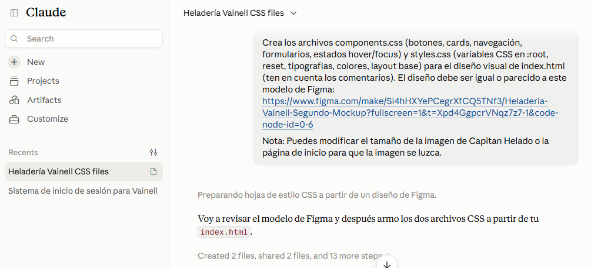

# spec-frontend.md — Desarrollador Frontend/CSS

**Proyecto:** Vainell
**Entrega:** Actividad Obligatoria N°2
**Rol:** Desarrollador Frontend/CSS
**Rama:** `feature/dev-frontend-css-add-styles` → `develop`
**Ruta:** `docs/03-specs/actividad-obligatoria-2/spec-frontend.md`


---

## PARTE A — Planificación previa

## 1. Qué se va a hacer

Escribir los estilos del `index.html` de Vainell a partir del mockup de Figma, en dos archivos separados por responsabilidad:

| Archivo | Responsabilidad |
|---|---|
| `css/styles.css` | Variables en `:root` (paleta, tipografías, escala tipográfica, espaciados, radios, sombras, `--gutter`), reset, estilos base y layout de cada sección: header fijo, hero, franja de números, grillas de "¿Por qué Vainell?", "¿Cómo pedir?", testimonios y "Mi cuenta", formulario de pedido y footer. |
| `css/components.css` | Componentes reutilizables: navegación (menú del header, categorías del catálogo, links del footer), botones (principal, contorneado, "Agregar", envío de formularios), cards (¿Por qué?, pasos, testimonios, cuenta, tarjeta de Capitán Helado), formularios (campos y `fieldset` de modalidad), tablas del catálogo y estados `hover` / `focus-visible` / `active` / `disabled`. |

Puntos específicos del diseño:

- **Hero:** la tarjeta de Capitán Helado (`.hero-tarjeta`) ocupa toda su columna, con fondo menta y una animación suave de flotación (desactivada con `prefers-reduced-motion`), para que el personaje se luzca. La foto de los helados va debajo, en una banda ancha.
- **Catálogo:** cada fila de las tablas se ve como una card horizontal.

Fuera de alcance de este rol: `css/responsive.css` (media queries), que corresponde al Especialista en Responsive Design. Por eso los layouts de `styles.css` usan `grid` con `auto-fit/minmax` y `flex-wrap`: la página no se rompe antes de que existan los breakpoints.

El `index.html` solo recibe los `<link>` a las hojas de estilo en el `<head>`; no se modifica su estructura.

## 2. Por qué

- La consigna pide separar el CSS por responsabilidad (variables y layout vs. componentes vs. responsive).
- Centralizar colores, tipografías y espaciados en variables permite ajustar el diseño en un solo lugar, y que el Especialista en Responsive trabaje sobre los mismos valores.
- El HTML semántico de la Actividad N°1 casi no tiene clases, así que el diseño se aplica con selectores de elemento, `id` de sección y herencia.

## 3. Decisiones técnicas previstas

- **Selectores:** de elemento (`h1`, `table`), de id (`#catalogo`), descendientes e hijos directos (`main > section`, `body > header nav`), de atributo (`a[href="#mi-cuenta"]`, `button[type="submit"]`) y pseudoclases (`:hover`, `:focus-visible`, `:nth-child`, `:has()`). Clases solo donde ya existen en el HTML (`.hero-tarjeta`, `.cuenta-container`).
- **Header y footer:** se seleccionan como `body > header` y `body > footer`, porque cada testimonio también tiene un `<footer>` propio (el autor) que no debe heredar el layout del footer del sitio.
- **Herencia y especificidad:** fuente y color de texto definidos una vez en `body` y heredados. Los componentes mantienen especificidad baja y solo suben (ids) cuando hace falta distinguir un mismo elemento en contextos distintos (por ejemplo, el `nav` del header vs. el del footer vs. el del catálogo).
- **Box model:** `box-sizing: border-box` global; `padding`, `margin` y `border` declarados de forma explícita en cards, campos y botones.
- **Elementos en línea vs. bloque:** `a`, `span`, `em`, `strong` y `small` quedan en línea por defecto; pasan a `inline-flex` o `block` solo cuando lo necesitan (botones, marca del header, etiquetas del hero, emoji de los pasos). `img`, `figure`, `blockquote`, `address` y `label` son bloque; `img` en bloque evita el hueco inferior.
- **Layout:** `flex` para header, menús y filas de botones; `grid` para hero, números, tarjetas, pasos, testimonios, cuenta, formulario de pedido y footer.
- **Tablas:** el scroll horizontal, si hiciera falta, queda dentro del `div` de cada categoría (`overflow-x: auto`), nunca en la página.
- **Tipografías:** Fredoka para títulos y Nunito para el texto, cargadas con `@import` de Google Fonts y con tipografías del sistema como respaldo.
- **Paleta:** verde azulado `#1f7a70` (acción principal), menta `#aee9df`, dorado `#d9a441` y crema `#fffaf0` de fondo, tomados del logo y de Capitán Helado. Todos los valores se definen como variables en `:root` (`--color-*`, `--font-*`, `--fs-*`, `--space-*`, `--radius-*`, `--shadow-*`).
- **Valores de diseño:** como el archivo de Figma Make no está disponible para lectura automática, los valores iniciales son una propuesta derivada de los assets de la marca. Se contrastan con el mockup en la revisión manual (ver Parte B).
- **Comentarios:** cada bloque lleva un comentario que explica la decisión de estilo.

## 4. Criterios de aceptación

- [ ] `css/styles.css` existe y define variables en `:root`, reset, tipografías, colores y layout base coherente con el mockup.
- [ ] `css/components.css` existe y define botones, cards, navegación, tablas y formularios con estados `hover` y `focus`.
- [ ] `index.html` enlaza `styles.css` y `components.css` desde el `<head>` (en ese orden).
- [ ] Se usan distintos tipos de selectores y la especificidad se mantiene controlada.
- [ ] Box model con `padding`, `margin` y `border` explícitos.
- [ ] Elementos en línea y en bloque diferenciados mediante CSS.
- [ ] Hay comentarios explicativos sobre las decisiones de estilo.
- [ ] Paleta, tipografías y espaciados coinciden con el mockup actualizado de Figma.
- [ ] Las 10 secciones del `index.html` (header, inicio, características, ¿por qué Vainell?, catálogo, ¿cómo pedir?, pedido, mi cuenta, testimonios y footer) tienen estilo aplicado.
- [ ] El estilo de Capitán Helado en el hero lo destaca visualmente.
- [ ] No hay overflow horizontal causado por los estilos base (cada tabla scrollea dentro de su contenedor).
- [ ] Pruebas de integración realizadas con el Especialista en Responsive en GitHub Pages y localhost.
- [ ] Los bugs reportados por el QA Tester están resueltos antes del merge a `develop`.
- [ ] PR creada hacia `develop`, con `changelog.md` actualizado con el link a la PR.

---

## PARTE B — Cierre con evidencia

## 5. Prompt utilizado

**Herramienta usada:** Claude.ai. Esto debido a que Copilot generó un error inesperado a la hora de realizar el prompt asignado. Se recurrió a esta IA como último recurso luego de que se haya reintentado enviar el prompt reescrito varias veces.



Archivos adjuntados como contexto: `index.html`, `plan.md`, la consigna de la Actividad Obligatoria N°2 (PDF), la imagen de Capitán Helado y la imagen del logo de Vainell.


```
Crea los archivos components.css (botones, cards, navegación, formularios, estados hover/focus) y styles.css (variables CSS en :root, reset, tipografias, colores, layout base) para el diseño visual de index.html (ten en cuenta los comentarios). El diseño debe ser igual o parecido a este modelo de Figma: https://www.figma.com/make/Si4hHXYePCegrXfCQ5TNf3/Heladeria-Vainell-Segundo-Mockup?fullscreen=1&t=Xpd4GgpcrVNqz7z7-1&code-node-id=0-6

Nota: Puedes modificar el tamaño de la imagen de Capitan Helado o la página de inicio para que la imagen se luzca.
```

## 6. Resultado obtenido

```
Se generaron css/styles.css y css/components.css.

Colores y tipografías: no salen del Figma, que no pudo leerse. Se armó una paleta propia a partir del logo y de Capitán Helado (verde azulado, menta, dorado y crema) con Fredoka para títulos y Nunito para el texto. Todo está en las variables de :root, para poder compararlo con el mockup y ajustarlo.

styles.css: variables, reset, tipografía base y layout de cada sección (header fijo, hero en grid de dos columnas, franja de números, grillas de tarjetas, formulario de pedido, cuenta y footer).
components.css: navegación (header, categorías del catálogo y footer), botones, cards (incluida la tarjeta grande de Capitán Helado, con animación de flotación), formularios, tablas del catálogo y estados hover / focus-visible / active / disabled.

Controles realizados: se verificó que las llaves de ambos archivos estén balanceadas. No se abrió la página en un navegador.
```

## 7. Ajustes manuales realizados

- Se vincularon `styles.css` y `components.css` en el `<head>` de `index.html` para que funcionen en conjunto (junto con `responsive.css`, del otro rol).
- Se modificó la paleta de colores.
