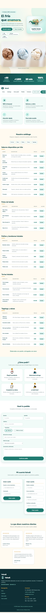

# Test Case 2 — Responsive en dispositivos móviles

## 1. Datos generales

- **Responsable:** Lautaro Chavez
- **Herramienta:** Playwright MCP mediante VS Code Copilot Agent Mode
- **URL de prueba:** `http://127.0.0.1:3000/index.html?vscode-livepreview=true`
- **Archivo evaluado:** `index.html`
- **Dispositivos y tamaños de viewport:** iPhone (390 × 844), Samsung Galaxy (360 × 800) y iPad (768 × 1024).

## 2. Objetivo

Verificar que la página de Heladería Vainell se adapte a diferentes tamaños de pantalla, que sus secciones principales sean visibles y que no se produzca desbordamiento horizontal que dificulte la navegación.

## 3. Resultados del Momento 1 — Testing pre-merge

El registro inicial documentó problemas de desbordamiento horizontal en los tamaños correspondientes a iPhone y Samsung Galaxy, mientras que el iPad se registró como aprobado.

- **iPhone:** FAIL. Se informó un posible desbordamiento horizontal asociado a la imagen de la sección Hero.
- **Samsung Galaxy:** FAIL. El registro anterior informó un ancho del documento de 449 px para un viewport de 360 px, con un desbordamiento de 89 px.
- **iPad:** PASS. El registro anterior indicó que la página se visualizaba correctamente en un viewport de 768 × 1024.

**Observación sobre el registro histórico:** el documento original contiene descripciones contradictorias sobre el desbordamiento y menciona un número de issue de GitHub sin confirmar. Por ese motivo, estos resultados se conservan como antecedentes del Momento 1 y no se consideran una verificación independiente del estado actual del código.

## 4. Resultados del Momento 2 — Nueva ejecución

Se volvió a verificar la página con Playwright MCP en Chromium, modificando el viewport para representar los tres tamaños de pantalla solicitados.

En los tres casos, el documento alcanzó `readyState: complete` y la navegación, la sección Hero, el catálogo y el formulario estuvieron visibles.

| Dispositivo / viewport | Resultado | `innerWidth × innerHeight` | `clientWidth` | `scrollWidth` | Desbordamiento horizontal |
|---|---|---:|---:|---:|---|
| iPhone (390 × 844) | PASS | 390 × 844 | 375 | 375 | No |
| Samsung Galaxy (360 × 800) | PASS | 360 × 800 | 345 | 345 | No |
| iPad (768 × 1024) | PASS | 768 × 1024 | 753 | 753 | No |

### Verificación de controles

En los tres tamaños, los controles del formulario se encontraron visibles, habilitados, editables y accesibles mediante el foco. También se verificó que aceptaran interacción mediante el puntero.

**El formulario no se envió** durante esta prueba, ya que el objetivo fue comprobar el comportamiento responsive y la disponibilidad de los controles.

### Evidencias del Momento 2

**iPhone — 390 × 844**

**Samsung Galaxy — 360 × 800**

**iPad — 768 × 1024**

## 5. Alcance y limitaciones

- La verificación del Momento 2 se realizó en Chromium mediante Playwright MCP.
- Se utilizaron distintos tamaños de viewport; esto no equivale a probar en dispositivos físicos reales.
- No se documentaron pruebas del Momento 2 en Firefox, Safari o Edge.
- La diferencia observada entre `innerWidth` y `clientWidth` fue de 15 px en los tres tamaños. Como `scrollWidth` coincidió con `clientWidth` en todos los casos, no se detectó desbordamiento horizontal del documento durante estas pruebas.
- Los resultados corresponden a la página y al estado del código disponibles durante la ejecución.

## 6. Conclusión

**Resultado del Momento 2: PASS en los tres tamaños de viewport probados.**

En la nueva ejecución, la página cargó correctamente, sus secciones principales permanecieron visibles y no se detectó desbordamiento horizontal en los viewports de iPhone, Samsung Galaxy e iPad.

Estos resultados describen la verificación realizada en Chromium y no reemplazan las pruebas en otros navegadores ni en dispositivos físicos. Los hallazgos del Momento 1 quedan documentados como antecedentes históricos, pendientes de reconciliación con el registro original y sin atribuirles un issue de GitHub cuyo número no fue verificado.
