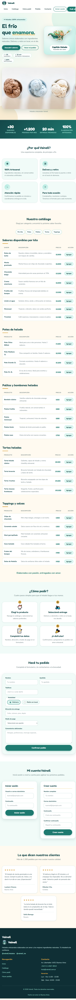

# Test Case 3 — Performance y Carga de Página

## 1. Datos generales

- **Responsable:** Lautaro Chavez
- **Herramienta:** Playwright MCP mediante VS Code Copilot Agent Mode
- **URL de prueba:** `http://127.0.0.1:3000/index.html?vscode-livepreview=true`
- **API utilizada:** Navigation Timing y Resource Timing.
- **Momento de ejecución documentado:** Momento 2.
- **Momento 1:** Se conservan sus antecedentes en el historial previo del documento, si corresponde.

## 2. Objetivo

Evaluar el tiempo de respuesta y carga de la página de Heladería Vainell mediante la Performance API del navegador. También se busca identificar los recursos con mayor duración y tamaño transferido, y registrar posibles errores de carga.

## 3. Procedimiento

1. Se abrió la página mediante Playwright MCP.
2. Se consultó `document.readyState` hasta confirmar el estado `complete`.
3. Se midieron los tiempos de navegación mediante `window.performance.getEntriesByType('navigation')[0]`.
4. Se inspeccionaron los recursos mediante `window.performance.getEntriesByType('resource')`.
5. Se registraron las duraciones y los tamaños transferidos disponibles.
6. Se tomó una captura de pantalla de la página cargada.

## 4. Resultados del Momento 2

### 4.1 Métricas de navegación

| Métrica | Cálculo | Resultado |
|---|---|---:|
| TTFB | `responseStart - requestStart` | 2,6000003814697266 ms |
| DOMContentLoaded | `domContentLoadedEventEnd - fetchStart` | 32,80000019073486 ms |
| Tiempo total de carga | `loadEventEnd - fetchStart` | 79,2000002861023 ms |

El documento alcanzó `document.readyState === "complete"`. La métrica `loadEventEnd` fue distinta de cero en la consulta realizada.

**Importante:** el TTFB registrado utiliza el cálculo indicado en el caso de prueba (`responseStart - requestStart`). No equivale al cálculo habitual de TTFB desde el inicio de la solicitud (`responseStart - requestStart` sí mide ese intervalo de respuesta, pero no incluye necesariamente el tiempo previo de preparación de la solicitud). Estos valores corresponden a la ejecución local observada y no constituyen una garantía de rendimiento en producción.

### 4.2 Recursos destacados

Los siguientes recursos se ordenaron por duración medida. Los tamaños corresponden a `transferSize`, expresado en bytes.

| Recurso | Duración | Tamaño transferido |
|---|---:|---:|
| `imagenes/logo_vainell.png` | 39,40000009536743 ms | 2.530.959 B |
| `imagenes/capitan-helado-reboot.png` | 32,40000009536743 ms | 1.612.260 B |
| `imagenes/helados%20Vainell.png` | 20,199999809265137 ms | 123.412 B |
| `css/components.css` | 19,199999809265137 ms | 16.480 B |
| `css/responsive.css` | 19,100000381469727 ms | 18.520 B |
| `css/styles.css` | 15,400000095367432 ms | 17.041 B |
| `___vscode_livepreview_injected_script` | 12,700000286102295 ms | 9.574 B |
| Google Fonts CSS | 0 ms | 0 B |
| Fuente Fredoka (`.woff2`) | 0 ms | 0 B |
| Fuente Nunito (`.woff2`) | 0 ms | 0 B |

### 4.3 Análisis de los resultados

- La imagen `logo_vainell.png` fue el recurso destacado con mayor duración y mayor tamaño transferido.
- La imagen `capitan-helado-reboot.png` ocupó el segundo lugar en ambas mediciones.
- Los archivos CSS mostraron duraciones inferiores a las de las dos imágenes principales.
- Los recursos de Google Fonts presentaron `transferSize` igual a cero, aunque se observaron valores en `encodedBodySize`. Esto puede relacionarse con la caché o con restricciones de medición entre orígenes.
- Las mediciones permiten identificar qué recursos convendría revisar primero, pero no demuestran por sí solas que exista un problema de rendimiento.

### 4.4 Errores observados

Se registró un error HTTP 404 al solicitar:

`http://127.0.0.1:3000/favicon.ico`

Según el informe de la ejecución, los demás recursos inspeccionados respondieron con estado HTTP 200 y no se observaron otros errores de consola.

## 5. Evidencia

Captura de pantalla correspondiente al Momento 2:

Archivo: `docs/04-testing/evidencia-test-case-3-momento-2.png`.

## 6. Alcance y limitaciones

- La prueba se realizó en un entorno local mediante Chromium y Playwright MCP.
- Los tiempos pueden variar según el equipo, el servidor local, la caché y las condiciones de ejecución.
- `transferSize` no siempre refleja el tamaño real del recurso, especialmente cuando intervienen la caché o las restricciones de medición entre orígenes.
- No se realizó una prueba de carga con múltiples usuarios ni una medición desde un servidor de producción.
- No se aplicaron modificaciones al código de la aplicación durante esta ejecución.

## 7. Conclusión

La página alcanzó el estado `complete` y el tiempo total de carga medido fue de aproximadamente 79,2 ms en esta ejecución local. Las imágenes del logo y del capitán fueron los recursos destacados con mayor duración y tamaño transferido, por lo que podrían ser los primeros candidatos a revisar si se busca optimizar la carga.

También se detectó un error 404 para `favicon.ico`, que queda registrado como hallazgo. Estos resultados describen una ejecución puntual y no deben interpretarse como una medición universal del rendimiento de la aplicación.
