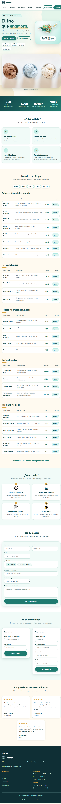

# Test Case 4 — Accesibilidad Web (axe-core)

- **Momento de ejecución:** Momento 1 (Testing pre-merge) y Momento 2.
- **Herramienta utilizada:** Playwright MCP (`@playwright/mcp`) con axe-core 4.7.2.
- **Responsable:** Lautaro Chavez.
- **Rama del registro inicial:** `feature/doc-qa-tester-add-test-cases`.

---

## 1. Objetivo

Evaluar la accesibilidad web de Heladería Vainell mediante una auditoría automatizada con axe-core, revisando posibles problemas relacionados con WCAG, la semántica de la interfaz y los elementos interactivos.

---

## 2. Prompt utilizado en Copilot Agent Mode — Momento 1

```text
Usa Playwright MCP para realizar la auditoría del Test Case 4: Accesibilidad Web en la aplicación local de Heladería Vainell.

URL:
http://localhost:3000

Instrucciones:
1. Abre la página.
2. Inyecta la librería axe-core en la página.
3. Ejecuta axe.run() y analiza los resultados.
4. Reporta las violaciones por nivel de impacto e indica los elementos HTML afectados.
5. Si encuentras violaciones críticas o graves, prepara un issue de tipo bug en GitHub.
6. Toma una captura de pantalla como evidencia.

No modifiques ningún archivo del proyecto.
```

---

## 3. Resultados del Momento 2 — Auditoría de accesibilidad

### 3.1 Datos de ejecución

- **Herramienta:** Playwright MCP.
- **Motor de auditoría:** axe-core 4.7.2, versión confirmada en el navegador.
- **URL:** `http://127.0.0.1:3000/index.html?vscode-livepreview=true`.
- **Estado de carga:** `document.readyState === "complete"`.

### 3.2 Resumen de resultados

| Indicador | Resultado |
|---|---:|
| Violaciones automáticas confirmadas | 0 |
| Impacto crítico | 0 |
| Impacto grave (`serious`) | 0 |
| Impacto moderado | 0 |
| Impacto menor | 0 |
| Reglas aprobadas | 47 |
| Reglas incompletas | 2 |
| Reglas no aplicables | 39 |

No se detectaron violaciones automáticas confirmadas en esta ejecución. Las reglas incompletas requieren una evaluación adicional y no deben contabilizarse como violaciones confirmadas.

### 3.3 Reglas incompletas

| Regla | Impacto indicado por axe | Nodos señalados | Evaluación pendiente |
|---|---|---:|---|
| `aria-allowed-attr` | Serious | 3 | Revisar el uso de `aria-label` en los párrafos de puntuación de los testimonios. |
| `color-contrast` | Serious | 31 | Comprobar manualmente el contraste entre el texto y sus fondos. |

**Regla `aria-allowed-attr`:** los nodos señalados corresponden a párrafos de puntuación de los testimonios que utilizan `aria-label="5 de 5 estrellas"`. Se debe revisar si el atributo es apropiado para esos elementos y cómo lo interpretan las tecnologías de asistencia.

**Regla `color-contrast`:** entre los elementos señalados se encuentran el título del hero (`#titulo-inicio`), enlaces del hero, datos destacados, comentarios (`#comentarios`) y puntuaciones de testimonios. Se debe revisar el contraste efectivo de cada elemento antes de determinar si existe una infracción.

Estos resultados están marcados como incompletos por axe y no constituyen, por sí solos, errores confirmados.

### 3.4 Consola del navegador

Se registró un error HTTP 404 al solicitar:

`http://127.0.0.1:3000/favicon.ico`

Según la inspección realizada, no se registraron otras entradas de error de consola. Este hallazgo se documenta por separado de la auditoría de accesibilidad.

### 3.5 Evidencia del Momento 2

Captura de pantalla de la página cargada durante la auditoría:



Archivo: `docs/04-testing/evidencia-test-case-4-momento-2.png`.

### 3.6 Alcance y limitaciones

- La auditoría automatizada se ejecutó con axe-core 4.7.2.
- Cero violaciones automáticas confirmadas no significa que la página cumpla íntegramente con WCAG.
- Las dos reglas incompletas requieren evaluación manual.
- No se considera verificada la accesibilidad mediante teclado, lectores de pantalla, ampliación y otras pruebas manuales que no estén documentadas en esta ejecución.
- No se modificaron archivos de la aplicación durante la auditoría.

### 3.7 Conclusión del Momento 2

**Resultado automático: 0 violaciones confirmadas.**

La auditoría dejó dos reglas pendientes de revisión manual: `aria-allowed-attr` y `color-contrast`. Hasta completar esas comprobaciones y las pruebas manuales correspondientes, no se puede afirmar que la aplicación cumpla integralmente con WCAG.

No se crearon issues de GitHub durante esta ejecución.

---

## 4. Registro histórico del Momento 1

El documento original describía la planificación de la auditoría con Playwright MCP y axe-core 4.7.2. En el contenido histórico compartido no se incluyeron resultados concretos de esa ejecución, por lo que no se atribuyen al Momento 1 métricas ni hallazgos que no hayan sido verificados.
