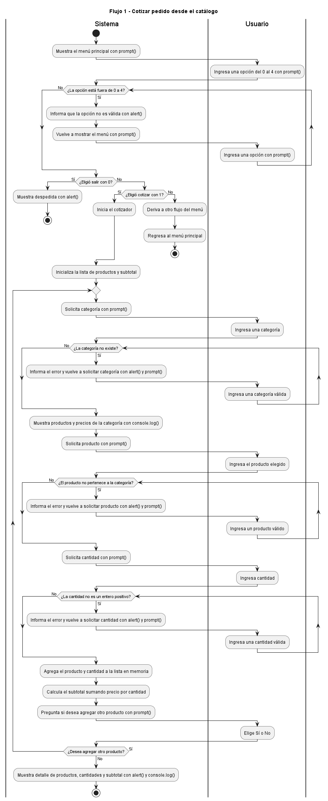
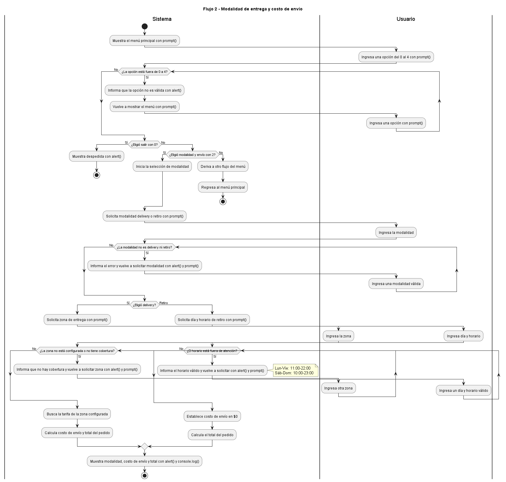
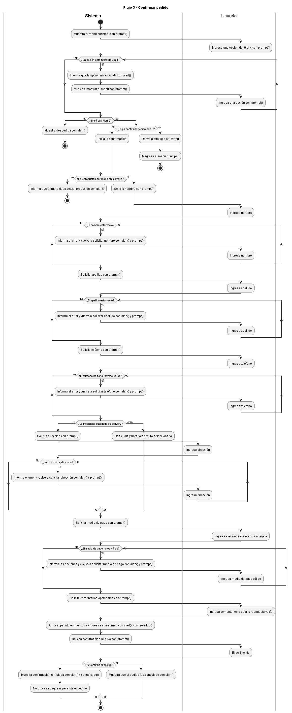
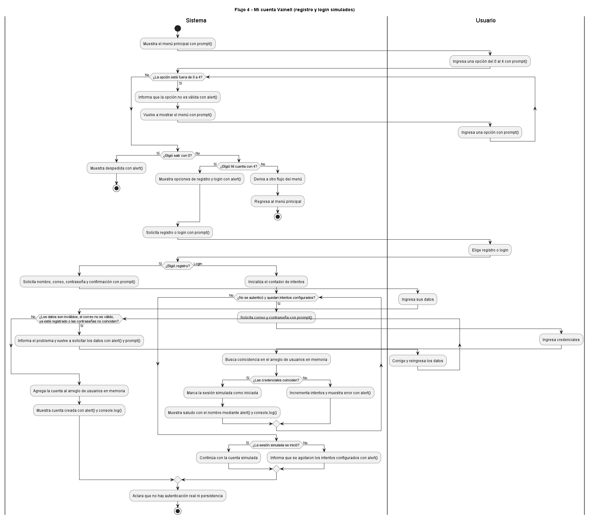

# Diagramas de actividades — Heladería Vainell

Los cuatro diagramas describen los flujos previstos para el simulador de pedidos. Las interacciones se modelan con `prompt()`, `alert()` y `console.log()`; los datos solo viven en memoria y no se procesan pagos ni se persisten pedidos o cuentas.

## Índice

### 1. Cotizar pedido desde el catálogo

Selecciona categoría y producto, valida una cantidad positiva, incorpora productos a una lista en memoria y calcula el subtotal. Las categorías y precios provienen del catálogo de `index.html`.

[Fuente PlantUML](./actividad-flujo-1-cotizar-pedido.puml)

### 2. Modalidad de entrega y costo de envío

Permite elegir delivery o retiro. Para delivery valida cobertura y obtiene la tarifa configurada para la zona. Para retiro valida el horario de atención y asigna costo de envío cero.

[Fuente PlantUML](./actividad-flujo-2-modalidad-envio.puml)

### 3. Confirmar pedido

Requiere productos cotizados, valida los datos del cliente y los requisitos de entrega, presenta un resumen y permite confirmar o cancelar la simulación.

[Fuente PlantUML](./actividad-flujo-3-confirmar-pedido.puml)

### 4. Mi cuenta Vainell

Permite crear una cuenta simulada o iniciar sesión comparando los datos con usuarios guardados en memoria. No representa autenticación real ni persistencia.

[Fuente PlantUML](./actividad-flujo-4-mi-cuenta.puml)

## Menú principal común

Cada diagrama comienza en el menú: las opciones `1` a `4` corresponden a los flujos listados y `0` sale. Las opciones inválidas se vuelven a solicitar. Si se selecciona otro flujo, el diagrama termina con la derivación al menú; ese flujo se representa en su propio diagrama.

## Supuestos y parámetros pendientes

- `plan.md` no define zonas, cobertura ni valores monetarios de envío. El flujo 2 consulta una tabla de zonas y tarifas que deberá configurarse antes de implementarlo.
- Para retiro, se usa el horario publicado en el footer de `index.html`: lunes a viernes de 11:00 a 22:00 y sábados y domingos de 10:00 a 23:00.
- El máximo de intentos de login queda como parámetro de la simulación; no se fija un número que no esté acordado en el plan.
- La validación del correo, teléfono y horarios es simulada en JavaScript; no reemplaza validaciones de un servicio real.
